# System Health Monitor

A small Flask system dashboard packaged with Docker and supported by Terraform, Kubernetes manifests, GitHub Actions, and a local observability stack.

> **Scope note:** the current Flask app serves `/` on port `5000`. It does not expose `/health` or `/metrics`, and this repository currently has no automated application test suite. The observability stack collects host and container metrics plus container logs; it cannot report application request counts or latency without app instrumentation.

## Prerequisites

- Docker Engine/Desktop with the Docker Compose v2 plugin.
- Git and a shell. Bash is required for `scripts/system_health.sh`; Windows users can use WSL.
- For AWS: Terraform 1.10+, AWS CLI v2, an AWS account, and permissions to create the resources described below.
- For Kubernetes: `kubectl`, a cluster such as kind, and the ability to load or pull the image.
- Optional local tools: Python 3.11+, Hadolint, Trivy, and Jenkins with a Docker-capable agent.

## Run locally with Docker Compose

Run from the repository root (the directory containing this README). The app alone is:

```bash
docker compose up -d --build
docker compose ps
```

Open <http://localhost:5000>. Stop it with `docker compose down`.

### Start the app and observability stack

Set a local Grafana password in your shell, then start all three Compose files. The last file joins the app and Prometheus on the shared network so Prometheus can scrape cAdvisor and Alloy can collect the app container logs.

PowerShell:

```powershell
$env:GRAFANA_ADMIN_PASSWORD = 'choose-a-long-local-password'
docker compose -f docker-compose.yml -f docker-compose.monitoring.yml -f compose.yml up -d --build
```

Bash:

```bash
export GRAFANA_ADMIN_PASSWORD='choose-a-long-local-password'
docker compose -f docker-compose.yml -f docker-compose.monitoring.yml -f compose.yml up -d --build
```

| Service | Address | Credentials / notes |
|---|---|---|
| Flask app | <http://localhost:5000> | Dashboard at `/` |
| Grafana | <http://localhost:3000> | `admin` / value of `GRAFANA_ADMIN_PASSWORD` |
| Prometheus | <http://localhost:9090> | Targets and host/container metrics |
| Loki | <http://localhost:3100> | Log API; use Grafana Explore to query logs |

Grafana provisions three dashboards from `monitoring/dashboards/`: **Python Application Dashboard** (app-container metrics), **Linux Host Monitoring**, and **Docker Container Monitoring**. In Grafana Explore, select Loki and query `{container=~".*system-health-app.*"}` to see app logs, or select Prometheus for host/container metrics. Grafana, Prometheus, and Loki bind to localhost; Alloy, Node Exporter, and cAdvisor are not published to the host.

Prometheus scrapes itself, Node Exporter, and cAdvisor. Node Exporter reports host metrics and cAdvisor reports container metrics. Alloy reads Docker container logs through the Docker socket and pushes them to Loki; Grafana queries Prometheus and Loki. The Docker socket is highly privileged despite its read-only mount. Node Exporter and cAdvisor use Linux host paths and may provide incomplete data on Docker Desktop, especially on Windows/macOS.

Stop the stack and remove its containers:

```bash
docker compose -f docker-compose.yml -f docker-compose.monitoring.yml -f compose.yml down
```

Add `-v` only when you also intend to delete persisted Prometheus, Loki, and Grafana data.

## Tests and validation

There is no `tests/` directory or configured test runner in this repository today. Do not treat a successful image build as an application test. Run a local HTTP smoke check after startup:

```bash
curl --fail --show-error http://localhost:5000/
```

The GitHub Actions workflow is intended to validate dashboard JSON, lint the Dockerfile with Hadolint, build and push the image, then scan it with Trivy for high/critical vulnerabilities. It does not yet run application tests. **Repository layout check:** the workflow paths currently assume a `Python-App/` subdirectory. Since this README and workflow are inside that directory, change `Python-App/monitoring/dashboards` to `monitoring/dashboards`, `Python-App/Dockerfile` to `Dockerfile`, and the Buildx context from `Python-App` to `.` before relying on the workflow in this repo. Terraform checks are shown in the Terraform section. If installed, additional checks include:

```bash
hadolint Dockerfile
shellcheck --severity=warning scripts/*.sh
trivy fs --exit-code 1 --ignore-unfixed --severity HIGH,CRITICAL .
```

## System health script

On Linux, WSL, or another Bash environment:

```bash
chmod +x scripts/system_health.sh
APP_URL=http://localhost:5000/ ./scripts/system_health.sh
```

The script reports CPU, memory, disk, load, uptime, processes, Docker status, and app HTTP status. It writes under `/var/log/python-app` when permitted and falls back to the current user's local data directory otherwise. To schedule it, review the `/opt/python-app` path in `scripts/crontab`, install the project at that path, then run `crontab scripts/crontab`.

## AWS infrastructure with Terraform

Terraform provisions an ECR repository, one Amazon Linux 2023 EC2 instance, an IAM instance profile for ECR pulls/CloudWatch/SSM, a security group, and a CloudWatch log group. The S3 backend bucket is deliberately external because Terraform must access it before it can initialize this state.

1. Create a dedicated S3 state bucket in `ap-south-1` (or update the configured region). Enable versioning, server-side encryption, and all S3 Block Public Access settings. Restrict bucket access to the Terraform operators and enable audit logging according to your organization policy.
2. Replace `allowed_cidr_blocks` in `terraform/terraform.tfvars` with a trusted public CIDR. The checked-in placeholder is not a usable address. The security group exposes app port 5000 only to those CIDRs. Consider setting `enable_public_ip = false` and using private subnets plus controlled ingress for a real production network.
3. From the repository root, enter `terraform/`, then initialize, format, validate, and inspect the plan:

   ```bash
   cd terraform
   terraform init -backend-config="bucket=YOUR_UNIQUE_STATE_BUCKET" -backend-config="region=ap-south-1"
   terraform fmt -check -recursive
   terraform validate
   terraform plan
   terraform apply
   ```

4. Record outputs and configure GitHub repository **Variables**: `AWS_REGION`, `ECR_REPOSITORY` (the repository name from `terraform output -raw ecr_repository_url`), `AWS_DEPLOY_ROLE_ARN`, and `EC2_INSTANCE_ID` (from `terraform output -raw ec2_instance_id`).
5. Create an AWS IAM role trusted through GitHub OIDC, restricted to this repository and the `production` GitHub environment. Grant the workflow only ECR push and SSM send/invocation permissions for the target instance plus required describe calls. No AWS access keys or SSH key are used by the workflow.
6. Push to `main` or run the workflow manually. The instance needs outbound access to ECR, SSM, and CloudWatch Logs using internet/NAT or VPC endpoints.

The first Terraform apply prepares the host and systemd service. The first successful workflow publishes the image, writes its immutable image URI to the instance configuration through SSM, starts the service, and checks `http://127.0.0.1:5000/`.

Destroy only after reviewing the plan and confirming the target workspace/state:

```bash
terraform plan -destroy
terraform destroy
```

The ECR repository uses `force_delete = false` by default so Terraform will not silently delete stored images. The S3 state bucket is not part of this stack and should be retained.

## Kubernetes deployment

The manifests deploy two non-root replicas, a ClusterIP Service, an Ingress template, and a CPU HPA. Probes use TCP because the app has no separate health route. HPA requires Metrics Server.

For kind, from the repository root:

```bash
docker build -t python-app:local .
kind load docker-image python-app:local
kubectl apply -f k8s/
kubectl rollout status deployment/python-app -n python-app
kubectl get pods,service,hpa -n python-app
```

Open the service locally with:

```bash
kubectl port-forward -n python-app service/python-app-service 8080:80
```

Then visit <http://localhost:8080>. To use Ingress, install an Ingress controller, change `python-app.example.com` in `k8s/ingress.yaml` to a DNS name you control, and configure a TLS secret and certificate. The supplied ingress hostname is only a template. To roll back a Kubernetes rollout:

```bash
kubectl rollout undo deployment/python-app -n python-app
kubectl rollout status deployment/python-app -n python-app
```

For a registry deployment, update `image` in `k8s/deployment.yaml` to the full immutable ECR URI, ensure the cluster can authenticate to ECR, and apply the manifest. The checked-in image defaults to `python-app:local` for kind.

## Architecture

```mermaid
flowchart LR
  Dev[Developer] -->|commit / push| Git[Git repository]
  Git --> CI[GitHub Actions]
  CI --> Lint[Config validation + Hadolint]
  Lint --> Tests[Application tests\nnot present yet]
  Tests --> Build[Build immutable SHA image]
  Build --> Scan[Trivy image scan\nHIGH / CRITICAL gate]
  Scan --> ECR[Amazon ECR]
  ECR -->|image URI via SSM| EC2[EC2 + systemd + Docker]
  EC2 --> App[Flask app :5000]

  Build -->|local image| Kind[kind / Kubernetes]
  Kind --> K8s[Deployment → Service → Ingress\nHPA uses Metrics Server]

  App -->|container metrics| Cadvisor[cAdvisor]
  Host[Linux host] -->|host metrics| Node[Node Exporter]
  App -->|Docker logs via socket| Alloy[Grafana Alloy]
  EC2 -->|CloudWatch awslogs driver| CW[CloudWatch Logs]
  Alloy --> Loki[Loki]
  Cadvisor --> Prom[Prometheus]
  Node --> Prom
  Prom --> Grafana[Grafana dashboards]
  Loki --> Grafana
```



The production EC2 path sends application logs to CloudWatch Logs. The local Compose path sends Docker logs through Alloy to Loki. Prometheus currently scrapes host/container infrastructure metrics rather than Flask metrics because the app does not expose a metrics endpoint. Kubernetes resources are deployable separately; no Prometheus Operator or Kubernetes monitoring manifests are included.

## Design decisions

- **Base image:** the project uses `python:3.11-slim`, not Alpine or distroless. Slim keeps the familiar glibc-based Python environment and straightforward dependency installation. Alpine can reduce image size but may require musl-compatible wheels/build tooling. Distroless can reduce runtime contents further, but complicates Python packaging, shell-based diagnostics, and this app's current simple entrypoint. Revisit with image-size and vulnerability measurements.
- **EC2 vs ECS vs EKS:** EC2 is the smallest operational step for this assessment and supports the existing SSM/systemd flow. ECS would provide managed scheduling and health-aware replacement without requiring Kubernetes operations; it is a stronger next step for a production container service. EKS is justified when Kubernetes APIs/ecosystem are requirements, but its cluster/control-plane and operating costs are excessive for one small app. The Kubernetes manifests demonstrate a separate deployment target, not the AWS production path.
- **Image tags:** CI tags releases with the full Git commit SHA, and ECR tags are immutable. This makes a release traceable and prevents a tag from silently pointing to different contents. Deploy the exact built image; avoid `latest` for promotion or rollback.
- **Secrets:** CI uses GitHub OIDC to assume an AWS role; long-lived AWS keys and SSH keys are not required. Local Grafana uses an environment variable. Kubernetes Secret values are not committed; use an external secret manager or cluster secret mechanism for real credentials.
- **Log labels:** use bounded labels such as service and container. Do not label logs with request IDs, user IDs, or other unbounded values. Keep high-cardinality details in the log body. Alloy has Docker socket access, so run it only on a trusted development host or a tightly controlled agent.
- **State:** Terraform uses an S3 backend with encryption and lockfile locking. The bucket is a bootstrap dependency and must have versioning, public access blocked, and tightly scoped access.

## Deployment and rollback strategy

1. After correcting the workflow's documented `Python-App/` path assumptions for this repository root, a push to `main` runs config validation and Dockerfile linting. The publish job builds the image, tags it with the commit SHA, pushes it to ECR, then fails on unfixed HIGH/CRITICAL Trivy findings.
2. Only after a successful scan, the production environment deploy job uses OIDC and SSM to point EC2 at that exact image. It restarts the systemd service and checks the app homepage before reporting success.
3. The EC2 host runs a single container, so this is not a zero-downtime rollout. For stronger availability, move to ECS or use a load balancer with multiple instances and health-checked target replacement.
4. To roll back, choose the previous known-good ECR SHA tag, connect with Session Manager, set that full URI in `/etc/python-app/environment`, restart the service, and verify the local homepage:

   ```bash
   sudo sed -i 's|^IMAGE_URI=.*|IMAGE_URI=ACCOUNT.dkr.ecr.ap-south-1.amazonaws.com/REPOSITORY:PREVIOUS_SHA|' /etc/python-app/environment
   sudo systemctl restart python-app.service
   curl --fail http://127.0.0.1:5000/
   ```

   Record the rollback SHA and follow up with a normal CI deployment once the issue is fixed. In Kubernetes, use `kubectl rollout undo` as shown above.

## Security considerations

- Keep GitHub Actions permissions minimal. Use OIDC with a repository/environment-restricted trust policy; do not store AWS access keys or SSH private keys as repository secrets.
- Scan images before deployment with Trivy and enable ECR scan-on-push. Review findings and rebuild from updated dependencies/base images; the scan is not a substitute for patching.
- The EC2 instance role is separate from the CI role. Scope its ECR read access to the app repository and logs access to the app log group. Require IMDSv2 and use SSM instead of inbound SSH.
- Restrict port 5000 to trusted CIDRs or put the instance behind a TLS-terminating load balancer. The example Terraform config has a placeholder CIDR. Do not open the app or monitoring ports broadly to the Internet.
- Keep Terraform state private and versioned. Do not commit state, credentials, real `.tfvars`, Grafana passwords, or Kubernetes Secret values.
- The Dockerfile runs as a non-root user. Compose further drops Linux capabilities and uses a read-only root filesystem. Alloy's Docker socket remains a privileged host interface and must be protected.
- Configure TLS and authentication before exposing Grafana, Prometheus, Loki, or the Kubernetes Ingress outside a trusted network.

## Rough AWS monthly cost estimate

For a small, single-instance demonstration in `ap-south-1`, budget roughly **$15–$30 USD/month** before taxes, discounts, support, and unusual traffic. This assumes one Linux `t3.micro` running continuously (about $8/month at a reported $0.0112/hour), a 12 GiB gp3 root disk (about $1/month using the commonly listed $0.08/GB-month rate), one public IPv4 address (about $3.65/month at $0.005/hour), modest CloudWatch log ingestion/storage and ECR storage, and no NAT Gateway or load balancer. AWS's public IPv4 charge is documented at [VPC pricing](https://aws.amazon.com/vpc/pricing/); verify live instance and storage prices with the [AWS Pricing Calculator](https://calculator.aws/) before provisioning. EC2 price reference: [ap-south-1 t3.micro](https://www.doit.com/compute/compute/aws/ap-south-1/t3.micro); EBS pricing: [Amazon EBS](https://aws.amazon.com/ebs/pricing/).

This is not a high-availability production footprint: one `t3.micro` with 1 GiB RAM is a small demo host, and Terraform detailed monitoring, outbound data, snapshots, CloudWatch logs, and ECR retention can increase the bill. A production setup with multiple instances, an Application Load Balancer, NAT, or managed Kubernetes can cost several times more; model those resources in the AWS calculator for your traffic and availability targets.

## What I would improve with more time

- Add unit tests and an app health endpoint, then run tests in CI before building.
- Add Prometheus instrumentation for request count, error rate, and latency, then alert on service-level objectives.
- Replace the single EC2 deployment with ECS rolling deployments, a load balancer, and at least two instances across Availability Zones.
- Add a dedicated Terraform bootstrap stack for the state bucket, plus policy checks and plan review in CI.
- Add SBOM generation, image signing/provenance, dependency update automation, and a documented retention policy.
- Add TLS, external secret management, and an authenticated ingress configuration.
- Validate Compose, Kubernetes, Terraform, shell, and Prometheus/Alloy configuration in CI, and exercise a staging deployment before production.

## AI tools

AI assistance was used to review and improve DevOps configuration and documentation. The final submission should be reviewed by its author, and the author should be able to explain the infrastructure choices, CI workflow, and operational commands. No application code was changed as part of the DevOps work.
